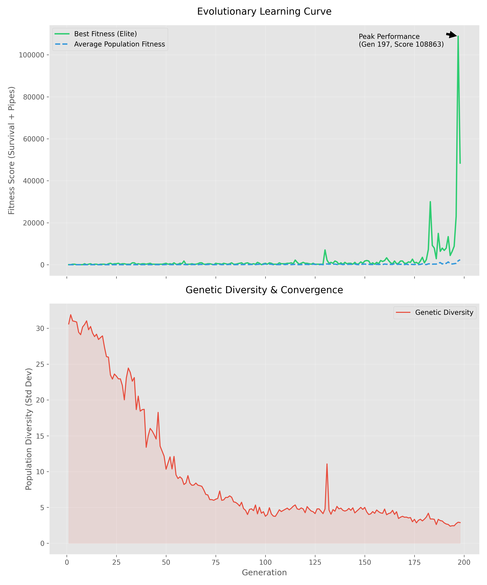

# 🧬 NeuroEvolution Flappy Bird
### A Deep Learning & Genetic Algorithm Research Sandbox

<div align="center">

[](https://github.com/antilneeraj/geneticalgorithm/stargazers)
[](https://opensource.org/licenses/MIT)
[](https://www.python.org/)
[](https://www.pygame.org/)<br>
[](https://gitpod.io/#https://github.com/antilneeraj/geneticalgorithm)

[**Quick Start**](#-quick-start) • [**Architecture**](#-neural-network-architecture) • [**Genetic Algorithm**](#-genetic-algorithm-implementation) • [**Benchmarks**](#-performance--results)

</div>

---

## Overview

This repository contains a solid piece of work in **NeuroEvolution** in Flappy Bird game. It is a research platform that aims at applying the principles of biological evolution in training artificial neural networks without backpropagation or the need for labeled data.

The system employs a **Genetic Algorithm (GA)** to modify the weights and biases of a constant, topology neural network. In this way, the agents (birds) learn to avoid the obstacles purely through survival of the fittest, i.e., evolution.

### Key Features for Researchers
- **Adaptive Evolutionary Parameters**: Mutation rates dynamically vary according to the population diversity to avoid stagnation of the solution.
- **Pluggable Architecture**: The modular design of the package allows you to swap the crossover strategies (Uniform, Single, Point, Arithmetic) and selection methods easily.
- **Real-time Diagnostics**: You can keep track of the "brain" of the best, performing agent live.
- **Serialization**: You can save and reload the whole state of the best neural networks (in JSON format) for subsequent examination or transfer learning.
- **Headless Training**: The game logic is decoupled which allows for high, speed training (configurable).

---

## Neural Network Architecture

Each agent is controlled by a feed-forward neural network. The topology is fixed, while the weights and biases are the subject of evolution.

### **Topology**
- **Input Layer (4 Nodes)**:
  1. `Bird Y` (Normalized 0-1)
  2. `Bird Velocity` (Normalized 0-1)
  3. `Distance to Next Pipe (X)` (Normalized 0-1)
  4. `Vertical Distance to Gap (Y)` (Normalized, centered at 0.5)
- **Hidden Layers**: Fully connected layers. Default configuration: `[6, 4]` neurons.
- **Output Layer (1 Node)**: Jump probability.

### **Activation Functions**
- **Hidden Layers**: `Hyperbolic Tangent (tanh)` - Chosen for its zero-centered range `[-1, 1]`, allowing for stronger negative inhibition signals compared to Sigmoid.
- **Output Layer**: `Sigmoid` - Maps the final aggregation to a probability `[0, 1]`. A value `> 0.5` triggers a jump.

[](https://mermaid.live/edit#pako:eNp9kU1vwjAMhv9KZC5MKlU_SD9y4LIdYGJC2m4jOwSS0mptUqWJRof470uhaGiH5WQ7z_vask-wV1wAgYNmbYnWr1Qi91ZbCivZWtOh6fyBwgeazRZoGbrysuJcSLRmvdAoRNNk-L6qluEVi_5i0egyYtEF2zhqY41rgqbPtmnRAgU-_sU609cCrVBR1TWZFHnhdUarT0EmcRyP8eyr4qYkUXu812xGzW73vwY8aIRuWMXdAk6DAwVTikZQIC6UwhrNagpUnh3KrFFvvdwDMdoKD7Syh_KW2JYzI54q5vbY3Iotk-9K3adATnAEglMfJ9E8z7IkzeMUJx70QOIo8BOcxGmU4QznYZCcPfi-GAR-lmLPHWkYtWB1N_QXkgv9qKw0QNLMA8Ero_TL9Z6Xs55_APoMkWM)

---

## 🧬 Genetic Algorithm Implementation

The evolution engine drives the learning process through the following lifecycle:

1.  **Evaluation**: Each agent plays the game until collision.
    - Fitness Function: $F = t_{survival} + (100 \times N_{pipes}) - 50_{crash}$
2.  **Selection**: A subset of parents is chosen to reproduce.
    - Default: **Tournament Selection** (k=3). Robust against outliers.
3.  **Crossover**: Genetic material (weights/biases) is mixed.
    - Default: **Uniform Crossover**. Attributes are chosen randomly from either parent with equal probability, preserving genetic diversity better than single-point crossover for neural weights.
4.  **Mutation**: Random perturbations are applied to weights.
    - Default: **Gaussian Mutation**. Small values drawn from a normal distribution added to weights.
    - **Adaptive Logic**: If population diversity drops below threshold $\delta$, mutation rate $\mu$ is boosted.
5.  **Elitism & Immigrants**:
    - Top $N$ performers carry over unchanged (Elitism).
    - 10% of new population are randomized "Immigrants" to inject fresh genetic material.

---

## 🚀 Quick Start

### Prerequisites
- Python 3.8 or higher
- pip (Python Package Manager)

### Installation

```bash
# 1. Clone the repository
git clone https://github.com/antilneeraj/geneticalgorithm.git
cd geneticalgorithm

# 2. Install dependencies
pip install -r requirements.txt
```

### Usage Modes

**1. Watch the AI Learn (Training Mode)**
This is the default mode where you see evolution in action.
```bash
python main.py --mode ai_training --population 50 --fps 60
```
- Use `--no-sound` to speed up processing slightly.

**2. Play as Human**
Challenge yourself against the game physics.
```bash
python main.py --mode human
```

**3. Run Best Trained Model**
Load the best performing bird from previous runs.
```bash
python main.py --mode ai_play
```

---

## Configuration

Hyperparameters are located in `src/utils/constants.py`. Tweak these to experiment with evolutionary dynamics:

| Parameter | Default | Description |
|-----------|---------|-------------|
| `POPULATION_SIZE` | 150 | Number of agents per generation. Higher = more diversity but slower. |
| `MUTATION_RATE` | 0.1 | Base probability of a gene mutating. |
| `ELITE_COUNT` | 5 | Number of top agents preserved perfectly. |
| `NN_HIDDEN_NODES` | `[6, 4]` | Topology of the "Brain". |
| `ACTIVATION` | `tanh` | Activation function for hidden layers. |

---

## 🧪 Quick Experiments (Try These!)

Want to break the AI? Experiment with the evolutionary dynamics in `src/utils/constants.py`:

1. **The "Chaos" Test**: Set `MUTATION_RATE = 0.8`. Watch as the birds struggle to retain knowledge between generations.
2. **Minimalist Brain**: Change `NN_HIDDEN_NODES = [2]`. Can the agent solve the game with only 2 "neurons"? 
3. **Hyper-Selection**: Change `ELITE_COUNT` to 50. Watch how genetic diversity collapses as the "top" birds dominate the gene pool.

---

## 📊 Performance & Results

Typical convergence behavior observed with default parameters:

- **Gen 0-5**: Pure random behavior. Most birds crash immediately.
- **Gen 10-20**: "Wall-following" or "Floor-hugging" strategies emerge.
- **Gen 30-50**: Discovery of the gap. Agents begin to pass 1-5 pipes.
- **Gen 500+**: Mastery. Agents can play indefinitely.

*Note: Convergence speed is highly dependent on `POPULATION_SIZE` and `MUTATION_RATE`. Larger populations generally converge in fewer generations but take longer computation time per generation.*

### The Learning Curve
As the population evolves, the mean fitness (survival time) increases exponentially before plateauing as the solution space is optimized.

*Figure 1: Fitness progression over 100 generations showing rapid convergence (Blue) followed by elite optimization (Green).*

> **Note**: You can generate your own local stats plot by running the analysis script `plot_results.py` (see below) which parses the `data/statistics/evolution_stats.json` file.

---

## 📁 Project Tree

```
GeneticAlgorithm
├─ assets
│  ├─ images
│  │  └─ All graphics used in the game (bird, pipe, background, base)
│  └─ sounds
│     └─ All sound effects (flap, point, hit, die)
├─ collab.ipynb
├─ CONTRIBUTING.md
├─ data
│  ├─ high_score.txt
│  ├─ models
│  │  └─ best_bird.json
│  └─ statistics
│     ├─ evolution_stats.json
│     └─ training_results.png
├─ diagnostic_ai_debug.py
├─ LICENSE
├─ main.py
├─ plot_results.py
├─ readme.md
├─ requirements.txt
├─ src
│  ├─ ai
│  │  ├─ crossover.py
│  │  ├─ fitness.py
│  │  ├─ genetic_algorithm.py
│  │  ├─ mutation.py
│  │  ├─ neural_network.py
│  │  ├─ population.py
│  │  └─ selection.py
│  ├─ game
│  │  ├─ bird.py
│  │  ├─ game_engine.py
│  │  ├─ pipe.py
│  │  └─ renderer.py
│  └─ utils
│     ├─ asset_loader.py
│     └─ constants.py
├─ validateNN.py
└─ validate_ai_constants.py
```

---

## 🤝 Contributing

We welcome contributions from the research and open-source community!

1. **Fork** the repository.
2. Create a **Feature Branch** (`git checkout -b feature/NewSelectionMethod`).
3. Commit your changes.
4. Push to the branch.
5. Open a **Pull Request**.

Please ensure you run diagnostics before submitting:
```bash
python diagnostic_ai_debug.py
```

---

## 📜 License

This project is licensed under the MIT License - see the [LICENSE](LICENSE) file for details.

---

<div align="center">
Made with ☕ by Neeraj Antil
</div>